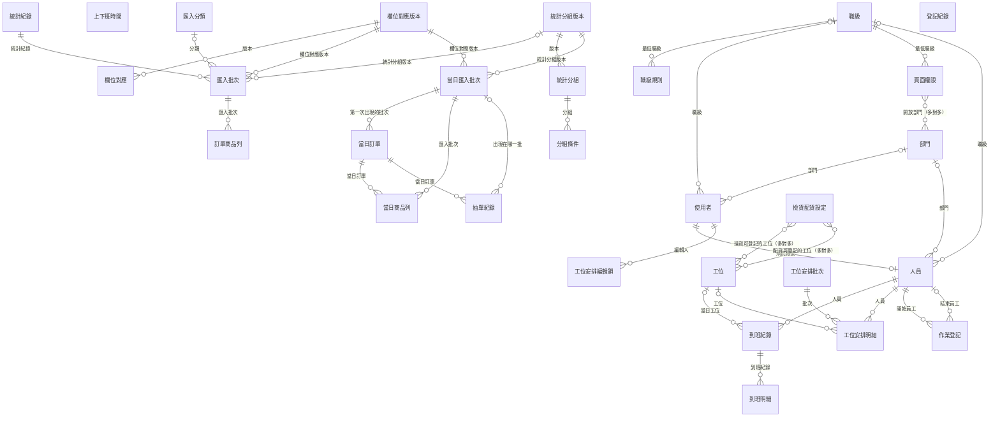
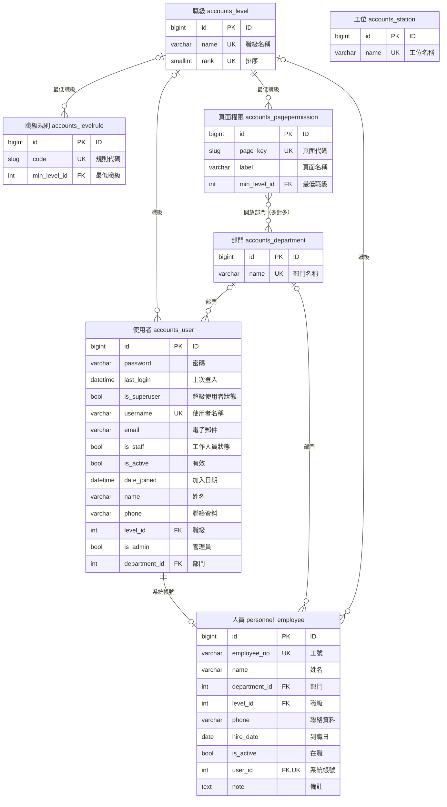
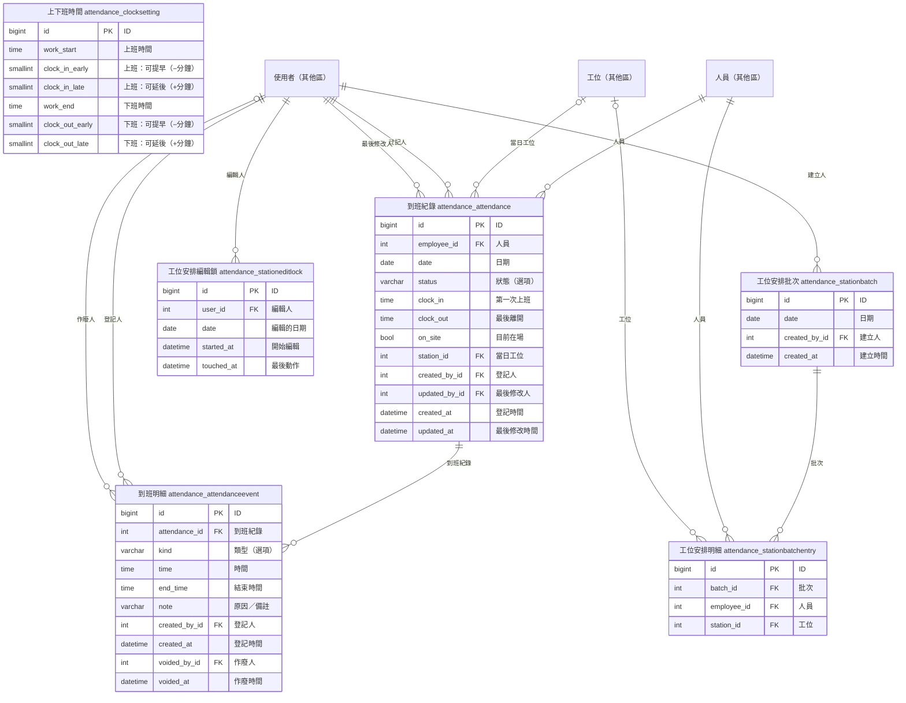
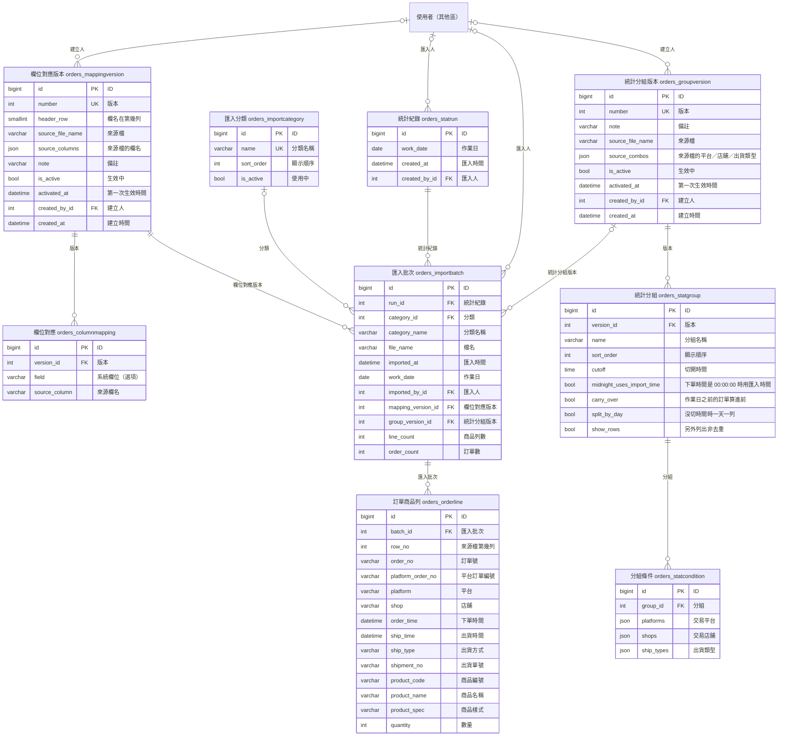
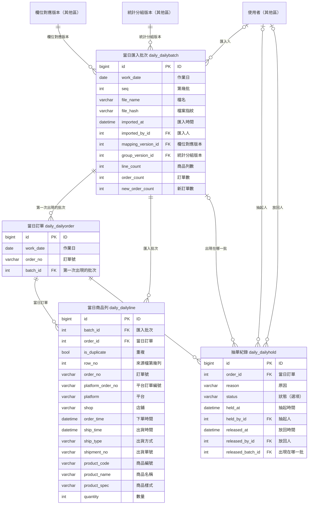
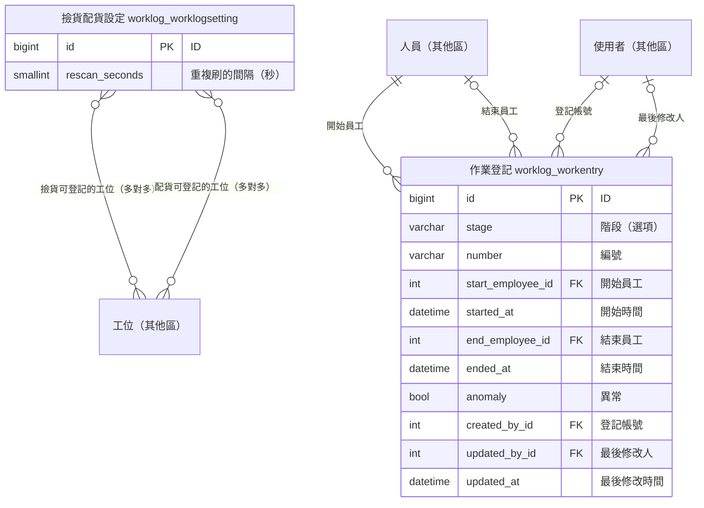
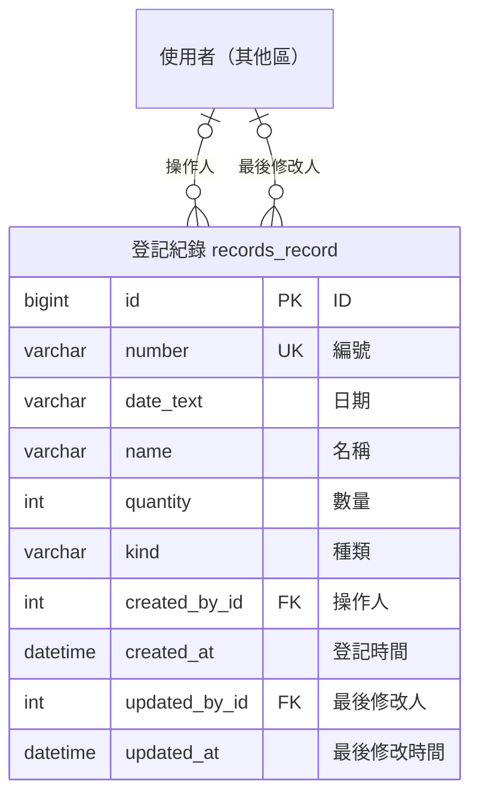

# 資料庫關聯圖

> 這份文件由 `docs/generate_er_diagram.py` 從 Django models 自動產生，不要手動修改。
> 改了 models 之後執行 `DB_ENGINE=sqlite python docs/generate_er_diagram.py` 重新產生。

圖例：`||--o{` 一對多、`|o--o{` 一對多（可空）、`||--o|` 一對一、`}o--o{` 多對多。
欄位標記：PK 主鍵、FK 外鍵、UK 不可重複。

## 總覽

只列資料表和主要關聯；「建立人／修改人」這類記錄操作者的外鍵（欄位名 `*_by`）在總覽省略，分區圖裡才畫出來。

## 沒有用外鍵、但用名稱對應的關係

- `records_record.kind`（種類）存的是統計分組 `orders_statgroup.name` 的文字，分組版本換了也不受影響。
- `worklog_workentry.number`（編號）存文字，登記當下比對：撿貨比對 `records_record.number`，配貨比對撿貨的編號。

## 帳號與組織

登入帳號、職級、部門、工位、頁面權限，以及人員資料。

## 到班與工位安排

每天的到班紀錄、打卡事件、批次排工位。

## 訂單匯入與統計

欄位對應版本、統計分組版本、匯入批次與訂單明細。

## 當日統計

當天多次匯入的訂單、明細與保留（hold）。

## 撿貨／配貨登記

撿貨、配貨的開始與結束人員，以及允許登記的工位設定。

## 登記紀錄

獨立的登記表，除了操作人之外不用外鍵關聯。

